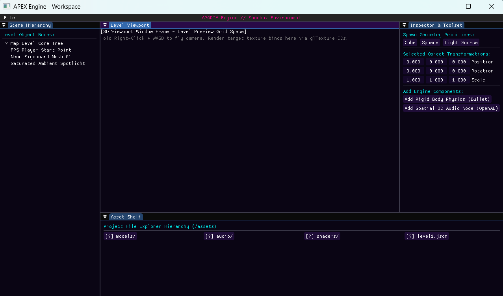
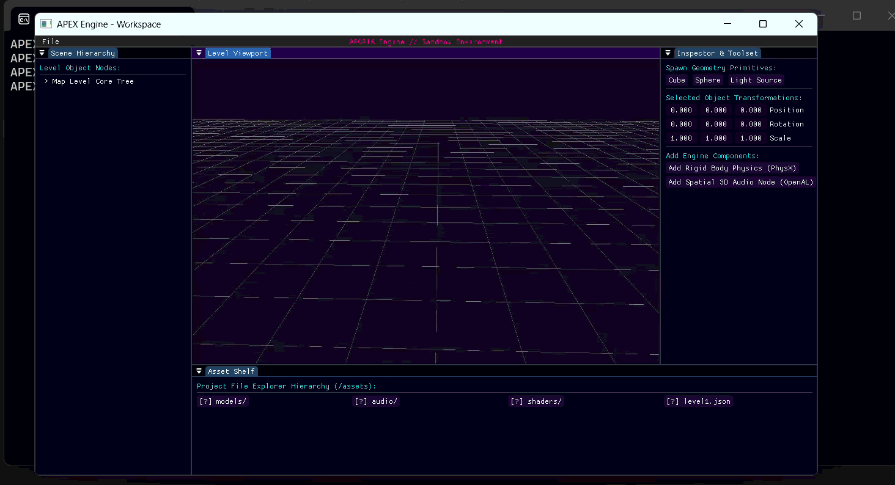

# A.P.E.X.-Aporia-Psychedelic-Engine-X-renderer
_This is the Custom Game Engine Built from scratch using C++ OpenGL/Vulkan by me. This Engine is Built and specifically Designed for making Fisrt Person Games with a Focus on Visual Post Processing Effects and Vivid Visuals. It uses a Simple Bespoke Architecture for easy solo debugging and development_. 

The Engine is Not Complete In Process...

-------------
## **DevLog Diaries**

### On 1/11/26
* #### *Got My Editor UI Running!*

I Added my Windows and Inputs for the editor using OpenGL 3.3 and for the Editor's UI Used the imgui - docking. Also Made the Engine monolithic by adding a EngineStateManager to toggle between Editor Mode and Gameplay Mode using Enums.

* *Here is the Output:*
  
  

